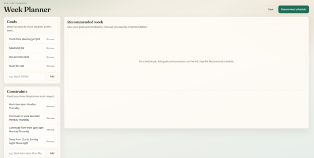
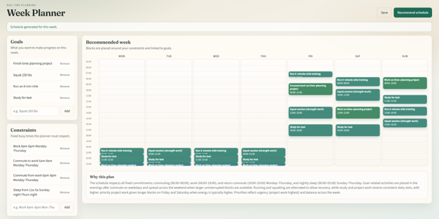

# RAG Time Planning

RAG Time Planning is an AI-assisted weekly planning application. A user enters their goals and fixed time constraints, and the app produces a proposed weekly schedule with time blocks, priorities, linked goals, and an explanation of the recommendation.

This project demonstrates a full-stack workflow with a React frontend, a FastAPI backend, retrieval-augmented prompting, structured LLM output validation, and user-facing error handling.

## Application workflow

1. **Load saved planning data** - The API reads the current goals and constraints from the local Markdown files in [`inputs/`](./inputs/).
2. **Edit goals and constraints** - The React UI lets the user add and remove goals and fixed commitments such as work, commuting, or sleep.
3. **Save the inputs** - The frontend sends the edited lists to the FastAPI endpoints, where they are normalized and persisted back to Markdown.
4. **Build the retrieval context** - When the user requests a recommendation, the backend creates Chroma documents for the goals and constraints and retrieves context relevant to the planning query.
5. **Generate a structured recommendation** - The retrieved context, complete input lists, and scheduling rules are sent to an OpenAI-compatible model through Groq's API.
6. **Validate the model response** - The backend extracts JSON from the model response and validates it against the Pydantic schedule schemas.
7. **Render the result** - The frontend displays the returned blocks in a Monday-through-Sunday calendar and presents the model's rationale below it.
8. **Handle failures safely** - Configuration, provider, timeout, rate-limit, and malformed-response failures are mapped to stable error codes and user-safe messages instead of exposing provider internals.

### Main components

- [`frontend/src/App.tsx`](./frontend/src/App.tsx) coordinates loading, editing, saving, generation, and status/error states.
- [`frontend/src/components/ItemList.tsx`](./frontend/src/components/ItemList.tsx) manages editable goals and constraints.
- [`frontend/src/components/WeekCalendar.tsx`](./frontend/src/components/WeekCalendar.tsx) renders the generated schedule as a weekly calendar.
- [`src/ui.py`](./src/ui.py) exposes the FastAPI routes and maps domain errors to safe HTTP responses.
- [`src/main.py`](./src/main.py) performs retrieval, builds the LLM prompt, parses the response, and validates the generated schedule.
- [`src/llm.py`](./src/llm.py) configures the OpenAI-compatible client and translates provider failures into application errors.
- [`src/schemas.py`](./src/schemas.py) defines the request and schedule data contracts.
- [`src/store.py`](./src/store.py) loads and saves the current local planning inputs.

## Screenshots




## Setup

### Prerequisites

- Python 3.10 or newer
- Node.js and npm
- An OpenAI-compatible API key and model name

### Backend

From the repository root:

```powershell
.\.venv\Scripts\Activate.ps1
pip install -r requirements.txt
```

Create a `.env` file in the repository root:

```text
AI_KEY=your-api-key
AI_URL=your-ai-url
AI_MODEL=your-model-name
```

The API currently uses Groq's OpenAI-compatible endpoint. Keep `.env` private; it is excluded from Git by `.gitignore`.

### Frontend

```powershell
cd frontend
npm install
```

## Run locally

Start the backend in one terminal:

```powershell
uvicorn src.ui:app --reload
```

Start the frontend in a second terminal:

```powershell
cd frontend
npm run dev
```

Open the application at [http://localhost:5173](http://localhost:5173). During development, Vite proxies `/api` requests to the FastAPI server at `http://127.0.0.1:8000`.

Interactive API documentation is available at [http://127.0.0.1:8000/docs](http://127.0.0.1:8000/docs), and the health check is available at `GET /api/health`.

## API

| Method | Path | Description |
|--------|------|-------------|
| `GET` | `/api/health` | Check API availability |
| `GET` | `/api/goals` | List saved goals |
| `PUT` | `/api/goals` | Replace saved goals |
| `GET` | `/api/constraints` | List saved constraints |
| `PUT` | `/api/constraints` | Replace saved constraints |
| `POST` | `/api/schedule/generate` | Generate a weekly schedule |

The schedule endpoint accepts optional `goals`, `constraints`, and `query` values. If the lists are omitted, it uses the values currently stored by the backend.

## Testing and frontend checks

Run the backend tests from the repository root:

```powershell
.\.venv\Scripts\Activate.ps1
pytest
```

Run the frontend type-checking build and linter:

```powershell
cd frontend
npm run build
npm run lint
```

## Current scope and limitations

- The local Markdown store is intended for a single-user/demo workflow; it is not a multi-user persistence layer.
- The generated schedule is an AI recommendation, not a guaranteed calendar conflict solver.
- Chroma is rebuilt for each generation request in the current prototype.
- A production deployment would need authentication, durable per-user storage, stricter schedule conflict validation, and deployment-specific environment configuration.
